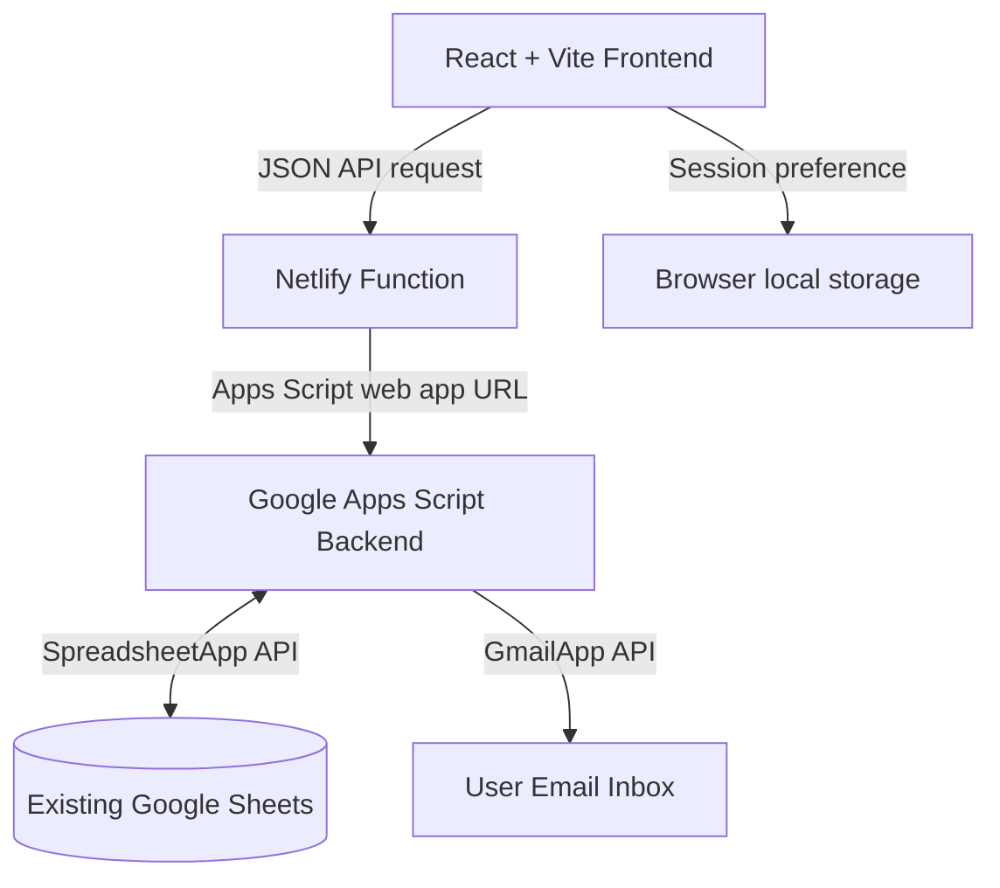

# Expense Pro — Advanced Personal Expense Tracker

[](#)
[](#)
[](#)

**Expense Pro** is a responsive React and Vite expense tracker. It retains the existing Google Apps Script backend and Google Sheets database; migrating the frontend does not move or recreate spreadsheet data.

The app includes expense entry and editing, month and all-record reports, charts and insights, CSV exports, recycle-bin restore, spreadsheet automation, and emailed PDF reports.

---

## 🚀 Key Features

*   **Premium Glassmorphic UI**: Beautiful responsive layout designed with modern CSS custom variables, vibrant colors, premium dark mode, and micro-animations for high-fidelity mobile and desktop experiences.
*   **Multi-User Portal & Security PINs**: Secure access control supporting multiple profiles (e.g., Admin and User views) secured with numeric PINs and a custom audit logging database.
*   **Rich Analytics Dashboard**: Review monthly and yearly spending, category summaries, and transaction insights.
*   **Advanced Data Operations**:
    *   Add and edit expenses, including moving an entry between months.
    *   Delete and restore expenses using the Google Sheets `Trash` sheet.
    *   Manage the expense-item list stored in Google Sheets.
*   **Reports and exports**: Search transactions and download CSV reports; send a PDF report using the existing Apps Script email service.
*   **Responsive design**: The React screens reuse the existing app styles, colors, and responsive layout.

---

## 🛠️ Technology Stack

| Layer | Technologies Used | Description |
| :--- | :--- | :--- |
| **Frontend** | React, Vite, Bootstrap 5, Font Awesome 6 | React single-page app with Vite development and production builds. |
| **API** | Netlify Function and Google Apps Script | The Netlify Function forwards frontend requests to the existing Apps Script web app. |
| **Database** | Google Sheets | Existing monthly sheets, consolidated data, audit log, item list, and recycle bin remain unchanged. |
| **Mailing** | Google Apps Script `GmailApp` / `MailApp` | The existing backend generates and emails PDF reports. |

---

## 📐 System Architecture

The React frontend calls the existing Apps Script API through a same-origin Netlify Function. Apps Script and the existing Google Sheets remain the source of truth:



### Database Schema Design
*   **Month Sheets** (e.g., `Jan`, `Feb`): Records monthly transaction items with `S.N`, `Unique ID`, `Date`, `Month`, `Item List`, `Amount`, `Credit & Remark`, and `Admin` fields.
*   **Consolidated Data** (`Data`): A unified sheet indexing all transactions across all years for multi-year reports.
*   **Audit Log** (`Login`): Logs timestamps, user actions, details, and unique IDs of all changes for full compliance.
*   **Recycle Bin** (`Trash`): Retains deleted transaction copies along with metadata describing who performed the delete operation.

---

## ⚙️ Installation & Setup

To run this project, you need a Google Account and basic familiarity with Google Sheets.

### Step 1: Prepare the Google Sheet
1.  Use the existing Google Sheets database. Create a new sheet only when setting up a fresh installation.
2.  Create sheet names for each month you wish to track (e.g., `Jan`, `Feb`, `Mar`, etc.).
3.  Add the following header row in cell `A1` of each month sheet:
    `S.N | Unique ID | Date | Month | Item List | Amount | Credit & Remark | Admin`
4.  Create another sheet named `Data` with the same headers to serve as the master consolidated sheet.
5.  Create a sheet named `Login` with the headers:
    `Timestamp | Action | Details | Affected ID | User | Ref | Name`
6.  Create a sheet named `Trash` with the headers:
    `S.N | Unique ID | Date | Month | Item List | Amount | Credit & Remark | Admin | Deleted By | Deleted At | Original Month`
7.  Copy your Spreadsheet ID from the URL:
    `https://docs.google.com/spreadsheets/d/SPREADSHEET_ID/edit`

### Step 2: Set up the Google Apps Script
1.  In your Google Sheet, click **Extensions** > **Apps Script**.
2.  Delete any default code in `Code.gs`.
3.  Add the code files from this repository:
    *   Rename `Backend.js` to `Backend.gs` and paste the backend logic.
    *   Create HTML files named exactly as they are structured in the repository (e.g., `Expense Tracker/Index.html`, `Expense Tracker/Style.html`, `Expense Tracker/Script.html`, `Expense Tracker/EmailService.gs`, etc.).
4.  At the top of your `Backend.gs`, update the global constants with your spreadsheet IDs:
    ```javascript
    const MAIN_ID = "YOUR_SPREADSHEET_ID";
    const CONSOLIDATED_ID = "YOUR_CONSOLIDATED_SPREADSHEET_ID_OR_SAME_AS_MAIN";
    ```

### Step 3: Run the React frontend
1. Install Node.js 18 or newer.
2. Install the frontend dependencies and start Vite:
   ```sh
   npm install
   npm run dev
   ```
3. For local Google Sheets API calls, create a `.env.local` file with your Apps Script deployment URL:
   ```text
   APPS_SCRIPT_WEB_APP_URL=https://script.google.com/macros/s/YOUR_DEPLOYMENT_ID/exec
   ```
   Vite uses this server-side URL to proxy requests during local development. Do not add `.env.local` to source control.

To update the Apps Script project locally, use [CLASP](https://github.com/google/clasp) (Command Line Apps Script Projects):
1.  Install clasp globally: `npm install -g @google/clasp`
2.  Log in to your Google Account: `clasp login`
3.  Clone your script using your script ID: `clasp clone "YOUR_SCRIPT_ID"`
4.  Make edits locally and push changes: `clasp push`

### Step 4: Deploy the Apps Script backend
1.  Inside the Apps Script editor, click **Deploy** > **New deployment**.
2.  Choose **Web app** as the deployment type.
3.  Configure the settings:
    *   **Description**: `Expense Pro API`
    *   **Execute as**: `Me (your email)`
    *   **Who has access**: `Anyone` (or `Anyone with Google Account` for extra privacy)
4.  Click **Deploy** and authorize the necessary Google Drive, Gmail, and Spreadsheet permissions.
5. Copy the generated **Web App URL** ending in `/exec`; configure it as `APPS_SCRIPT_WEB_APP_URL` in Netlify.

### Host the frontend on Netlify (Google Apps Script backend)
The Netlify build serves the Expense Tracker interface from Netlify and forwards its API calls to Google Apps Script. Sheets, Gmail, and the Apps Script backend remain in Google.

1. Deploy the Apps Script project as a web app with access set to **Anyone**. Copy its URL ending in `/exec`.
2. In Netlify, choose **Add new site** > **Import an existing project**, connect GitHub, and select `Anil1310/Expense-Pro`.
3. Netlify reads `netlify.toml` and builds the static frontend and API function from the repository.
4. In the Netlify site settings, add the environment variable `APPS_SCRIPT_WEB_APP_URL` with the Apps Script `/exec` URL as its value, then trigger a deploy.
5. When changing Apps Script backend code, push it with `clasp` and update the same Apps Script deployment. GitHub pushes trigger Netlify frontend deploys automatically.

The Netlify site URL hosts the React interface; the Apps Script deployment remains the API and Sheets backend. The Netlify build runs `npm run build`, and the existing `netlify/functions/apps-script.mjs` function proxies API requests. Do not use Netlify's manual ZIP upload because it does not deploy that function. Keep the GitHub repository private because the existing source contains spreadsheet identifiers.

---

## 🔒 Security & Data Integrity

*   **Apps Script authentication**: Sign-in is checked against the existing `Admin` sheet.
*   **Transactional Operations**: Month changes write the entry to the destination sheet before removing it from its original sheet.
*   **Audit Logging**: Expense changes and sign-in activity are logged in the `Login` sheet by the existing backend.

---

## 📄 License

This project is licensed under the MIT License - see the [LICENSE](LICENSE) file for details.
