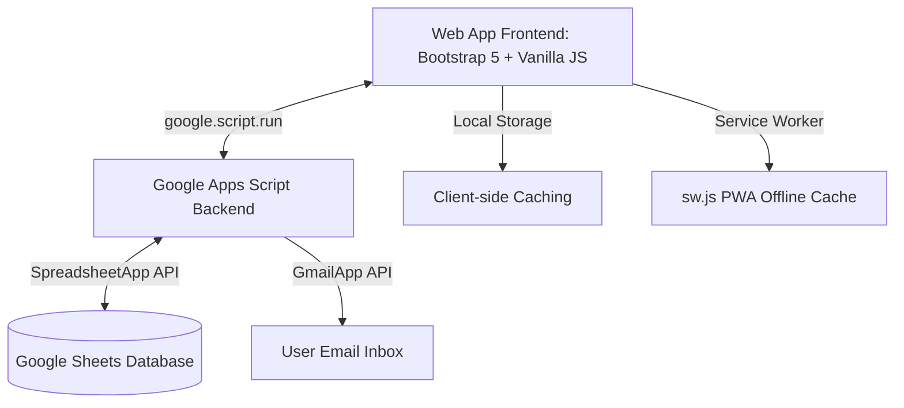

# Expense Pro — Advanced Personal Expense Tracker

[](#)
[](#)
[](#)
[](#)

**Expense Pro** is a modern, high-performance, and feature-rich Web Application designed to track, manage, and analyze personal finances. Powered by a **Google Apps Script** backend and a serverless **Google Sheets Database**, the application provides a sleek, responsive, and secure experience for multiple users.

With professional analytics, multi-user role management, automated report generation, and full PWA capabilities, Expense Pro transforms a simple Google Sheet into a full-scale Enterprise-grade Expense Management system.

---

## 🚀 Key Features

*   **Premium Glassmorphic UI**: Beautiful responsive layout designed with modern CSS custom variables, vibrant colors, premium dark mode, and micro-animations for high-fidelity mobile and desktop experiences.
*   **Multi-User Portal & Security PINs**: Secure access control supporting multiple profiles (e.g., Admin and User views) secured with numeric PINs and a custom audit logging database.
*   **Rich Analytics Dashboard**: Dynamic data visualization powered by **Chart.js** providing monthly comparisons, category-wise spending distribution, user spending breakdowns, and yearly trend lines.
*   **Advanced Data Operations**:
    *   **In-Place Editing & Month Switching**: Dynamically updates entries or transparently moves them across monthly database sheets on the fly.
    *   **Soft Deletion**: All deleted items are archived in a `Recycle Bin` (Trash sheet) with details of who deleted them and when.
    *   **Auto-Complete & Category Matcher**: An intelligent input engine that maps common keywords to matching category emoji icons (e.g., `rapido` → `🛵 Rapido`, `netflix` → `📺 Entertainment`).
*   **Mail & Export Services**: Export current month reports as Excel sheets, view them as formatted PDFs, or mail them directly as attachments using built-in Google Workspace integrations.
*   **Keyboard-Driven Command Palette**: Access pages, trigger syncs, search logs, and perform actions rapidly using an in-app `Cmd+K` style search palette.
*   **PWA & Offline Ready**: Service worker setup (`sw.js`) and application manifest (`manifest.json`) enabling mobile installations, custom splash screens, and localized data caching.

---

## 🛠️ Technology Stack

| Layer | Technologies Used | Description |
| :--- | :--- | :--- |
| **Frontend** | HTML5, Vanilla JavaScript (ES6+), Bootstrap 5, FontAwesome 6 | Core UI structures, responsive styling, and client-side interactions. |
| **Backend** | Google Apps Script (GAS V8 Runtime) | Serverless APIs executing server side within the Google Cloud. |
| **Database** | Google Sheets API (Master/Child Architecture) | Scalable database where each month has a dedicated sheet alongside a unified `Data` sheet. |
| **Data Viz** | Chart.js | Renders dynamic analytics charts for categories, years, and months. |
| **Caching** | Client Cache Wrapper (`window.expenseCache`) | Minimizes GAS API calls for fast loading and offline-ready reports. |
| **Mailing** | Google Apps Script `GmailApp` / `MailApp` | Automates emailing of formatted PDF reports to users. |

---

## 📐 System Architecture

The application implements a decoupled client-server architecture inside the Google Workspace ecosystem:



### Database Schema Design
*   **Month Sheets** (e.g., `Jan`, `Feb`): Records monthly transaction items with `S.N`, `Unique ID`, `Date`, `Month`, `Item List`, `Amount`, `Credit & Remark`, and `Admin` fields.
*   **Consolidated Data** (`Data`): A unified sheet indexing all transactions across all years for multi-year reports.
*   **Audit Log** (`Login`): Logs timestamps, user actions, details, and unique IDs of all changes for full compliance.
*   **Recycle Bin** (`Trash`): Retains deleted transaction copies along with metadata describing who performed the delete operation.

---

## ⚙️ Installation & Setup

To run this project, you need a Google Account and basic familiarity with Google Sheets.

### Step 1: Prepare the Google Sheet
1.  Create a new Google Sheet.
2.  Create sheet names for each month you wish to track (e.g., `Jan`, `Feb`, `Mar`, etc.).
3.  Add the following header row in cell `A1` of each month sheet:
    `S.N | Unique ID | Date | Month | Item List | Amount | Credit & Remark | Admin`
4.  Create another sheet named `Data` with the same headers to serve as the master consolidated sheet.
5.  Create a sheet named `Login` with the headers:
    `Timestamp | Action | Details | Affected ID | User | Ref | Name`
6.  Create a sheet named `Trash` with the headers:
    `S.N | Unique ID | Date | Month | Item List | Amount | Credit & Remark | Admin | Deleted By | Deleted At | Original Month`
7.  Copy your Spreadsheet ID from the URL:
    `https://docs.google.com/spreadsheets/d/SPREADSHEET_ID/edit`

### Step 2: Set up the Google Apps Script
1.  In your Google Sheet, click **Extensions** > **Apps Script**.
2.  Delete any default code in `Code.gs`.
3.  Add the code files from this repository:
    *   Rename `Backend.js` to `Backend.gs` and paste the backend logic.
    *   Create HTML files named exactly as they are structured in the repository (e.g., `Expense Tracker/Index.html`, `Expense Tracker/Style.html`, `Expense Tracker/Script.html`, `Expense Tracker/EmailService.gs`, etc.).
4.  At the top of your `Backend.gs`, update the global constants with your spreadsheet IDs:
    ```javascript
    const MAIN_ID = "YOUR_SPREADSHEET_ID";
    const CONSOLIDATED_ID = "YOUR_CONSOLIDATED_SPREADSHEET_ID_OR_SAME_AS_MAIN";
    ```

### Step 3: Local Development (Optional)
If you prefer editing files locally, you can use [CLASP](https://github.com/google/clasp) (Command Line Apps Script Projects):
1.  Install clasp globally: `npm install -g @google/clasp`
2.  Log in to your Google Account: `clasp login`
3.  Clone your script using your script ID: `clasp clone "YOUR_SCRIPT_ID"`
4.  Make edits locally and push changes: `clasp push`

### Step 4: Deploy the Web App
1.  Inside the Apps Script editor, click **Deploy** > **New deployment**.
2.  Choose **Web app** as the deployment type.
3.  Configure the settings:
    *   **Description**: `Expense Pro v1`
    *   **Execute as**: `Me (your email)`
    *   **Who has access**: `Anyone` (or `Anyone with Google Account` for extra privacy)
4.  Click **Deploy** and authorize the necessary Google Drive, Gmail, and Spreadsheet permissions.
5.  Copy the generated **Web App URL**. This is your live application link!

### Host the frontend on Netlify (Google Apps Script backend)
The Netlify build serves the Expense Tracker interface from Netlify and forwards its API calls to Google Apps Script. Sheets, Gmail, and the Apps Script backend remain in Google.

1. Deploy the Apps Script project as a web app with access set to **Anyone**. Copy its URL ending in `/exec`.
2. In Netlify, choose **Add new site** > **Import an existing project**, connect GitHub, and select `Anil1310/Expense-Pro`.
3. Netlify reads `netlify.toml` and builds the static frontend and API function from the repository.
4. In the Netlify site settings, add the environment variable `APPS_SCRIPT_WEB_APP_URL` with the Apps Script `/exec` URL as its value, then trigger a deploy.
5. When changing Apps Script backend code, push it with `clasp` and update the same Apps Script deployment. GitHub pushes trigger Netlify frontend deploys automatically.

The Netlify site URL hosts the interface; the Apps Script deployment remains the backend. Do not use Netlify's manual ZIP upload for this site because it does not deploy the required Netlify Function. Keep the GitHub repository private because the source contains spreadsheet identifiers.

---

## 🔒 Security & Data Integrity

*   **Role-Based Views**: User credentials restrict regular users from viewing developer settings or modifying spreadsheet structural elements.
*   **Transactional Operations**: Upgrades and updates are executed using transactional safety checks—a record is successfully appended to the destination sheet before it is safely removed from the source sheet.
*   **Audit Logging**: Every create, edit, move, delete, or authentication attempt triggers an automated row addition to the `Login` log sheet.

---

## 📄 License

This project is licensed under the MIT License - see the [LICENSE](LICENSE) file for details.
